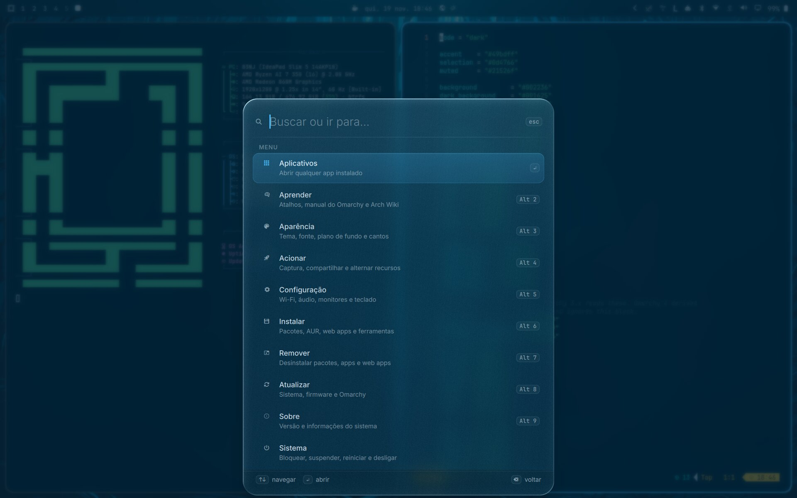

# Wars Star

A deep-blue [Omarchy](https://omarchy.org) theme inspired by a lightsaber duel in a frozen forest — icy blues, cool cyans and a touch of red.


## Screenshots

| Terminals (fastfetch + Neovim) | Omarchy menu |
| --- | --- |
|  |  |

## Install

```bash
omarchy theme install https://github.com/eusener/omarchy-wars-star.git
```

Or open **Menu → Install → Style → Theme** and paste the repository URL.

The theme is installed as **Wars Star** and applied right away. To switch back to it later:

```bash
omarchy theme set "Wars Star"
```

To update, run the install command again — it replaces the previous copy.

## What's included

| File | Purpose |
| --- | --- |
| `colors.toml` | Palette — Omarchy generates terminal, Hyprland border, btop, Neovim, browser, GTK and other app colors from it |
| `shell.*.toml` | Omarchy shell surfaces: bar, launcher, menu, notifications, popups and tooltips (translucent blue panels) |
| `icons.theme` | Icon theme (`Yaru-blue`) |
| `backgrounds/` | Wallpaper, plus an animated intro played when switching to the theme |
| `unlock.png`, `preview*.png` | Lock screen logo and theme-picker previews |
| `extras/hyprland-looknfeel.lua` | Optional window rounding, blur and transparency (see below) |

### Palette

| accent | background | foreground | red | yellow | green | cyan | magenta |
| --- | --- | --- | --- | --- | --- | --- | --- |
| `#49bdff` | `#002236` | `#cbdae5` | `#d195ef` | `#daa932` | `#49cc95` | `#00c9d0` | `#de91e2` |

## Optional: rounding, blur and transparency

For safety, `omarchy theme install` never loads Lua files from a theme repository, so the window look & feel tweaks are opt-in. The active border color is already derived from `accent`, so you don't need them for the theme to look right.

To enable them, append the file to your Hyprland config:

```bash
cat ~/.config/omarchy/themes/wars-star/extras/hyprland-looknfeel.lua >> ~/.config/hypr/looknfeel.lua
```

Note these settings then apply to every theme, not only Wars Star.

## Uninstall

```bash
omarchy theme set "Tokyo Night"   # or any other theme
rm -rf ~/.config/omarchy/themes/wars-star
```

## Credits

Wallpaper is fan art of *Star Wars: The Force Awakens* by Dan Mumford. Star Wars is a trademark of Lucasfilm Ltd. This is an unofficial, non-commercial fan theme.
