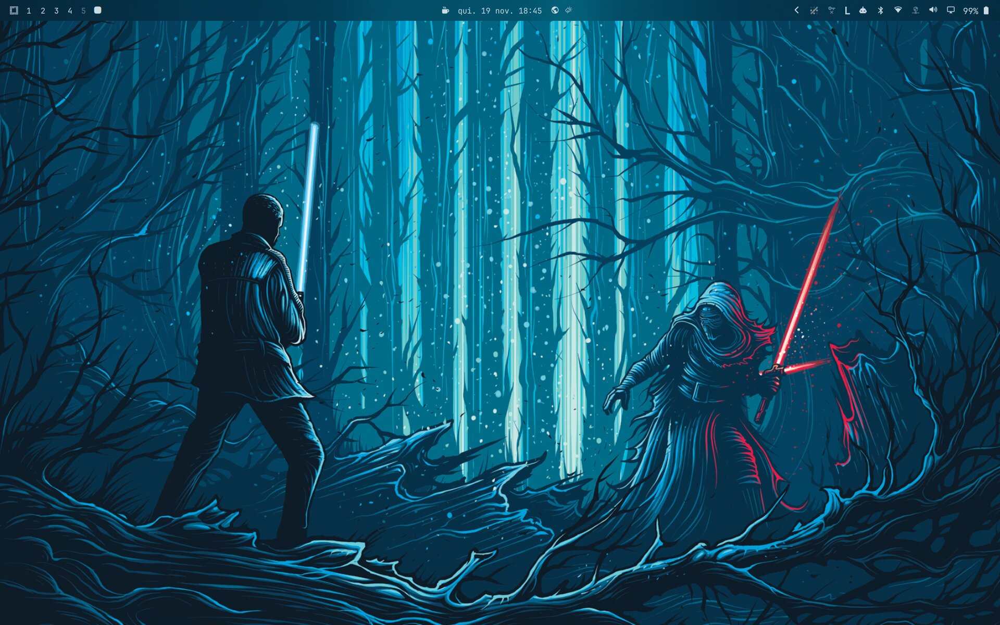
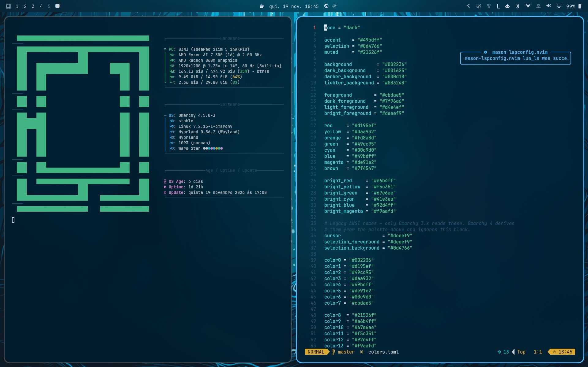

# Wars Star

Um tema [Omarchy](https://omarchy.org) em azul profundo, inspirado num duelo de sabres de luz numa floresta congelada — azuis gelados, cianos frios e um toque de vermelho.



## Prints

| Terminais (fastfetch + Neovim) | Menu do Omarchy |
| --- | --- |
|  |  |

## Instalação

```bash
omarchy theme install https://github.com/eusener/omarchy-wars-star.git
```

Ou abra **Menu → Instalar → Estilo → Tema** e cole a URL do repositório.

O tema é instalado como **Wars Star** e aplicado na hora. Para voltar a ele depois:

```bash
omarchy theme set "Wars Star"
```

Para atualizar, rode o comando de instalação de novo — ele substitui a cópia anterior.

## O que está incluído

| Arquivo | Função |
| --- | --- |
| `colors.toml` | Paleta — o Omarchy gera a partir dela as cores do terminal, da borda do Hyprland, do btop, do Neovim, do navegador, do GTK e de outros apps |
| `shell.*.toml` | Superfícies do Omarchy shell: barra, launcher, menu, notificações, popups e tooltips (painéis azuis translúcidos) |
| `icons.theme` | Tema de ícones (`Yaru-blue`) |
| `backgrounds/` | Wallpaper, mais uma intro animada exibida ao trocar para o tema |
| `unlock.png`, `preview*.png` | Logo da tela de bloqueio e prévias do seletor de temas |
| `extras/hyprland-looknfeel.lua` | Cantos arredondados, blur e transparência opcionais (veja abaixo) |

### Paleta

| accent | background | foreground | red | yellow | green | cyan | magenta |
| --- | --- | --- | --- | --- | --- | --- | --- |
| `#49bdff` | `#002236` | `#cbdae5` | `#d195ef` | `#daa932` | `#49cc95` | `#00c9d0` | `#de91e2` |

## Opcional: cantos arredondados, blur e transparência

Por segurança, o `omarchy theme install` nunca carrega arquivos Lua de um repositório de tema, então os ajustes visuais das janelas são opcionais. A cor da borda ativa já é derivada do `accent`, então eles não são necessários para o tema ficar correto.

Para ativá-los, acrescente o arquivo à sua configuração do Hyprland:

```bash
cat ~/.config/omarchy/themes/wars-star/extras/hyprland-looknfeel.lua >> ~/.config/hypr/looknfeel.lua
```

Observação: esses ajustes passam a valer para todos os temas, não só para o Wars Star.

## Desinstalação

```bash
omarchy theme set "Tokyo Night"   # ou qualquer outro tema
rm -rf ~/.config/omarchy/themes/wars-star
```

## Créditos

O wallpaper é uma fan art de *Star Wars: O Despertar da Força* feita por Dan Mumford. Star Wars é uma marca registrada da Lucasfilm Ltd. Este é um tema de fã não oficial e sem fins comerciais.
